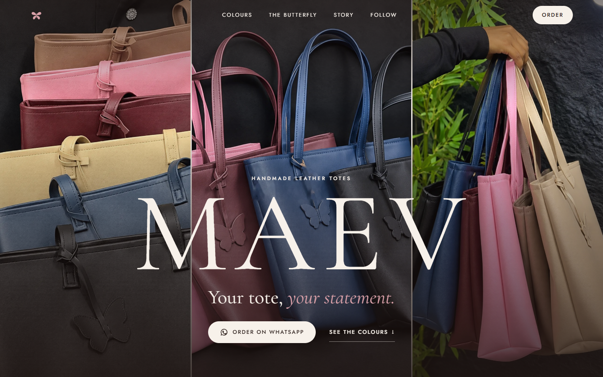
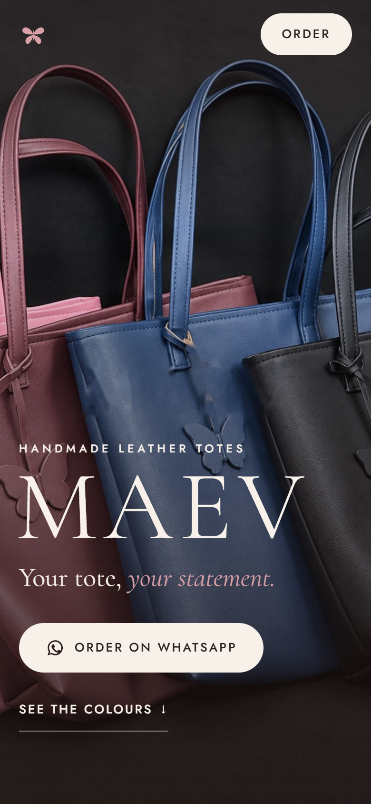

# MAEV

A single-page storefront for **MAEV**, a small Nigerian label making handmade leather tote bags. *Your tote, your statement.*

There's no cart and no checkout. MAEV sells over WhatsApp, so the site's job is to make the bags look as good as they are and get people into a chat about the one they want.

**Live:** https://maev-luxe.vercel.app



<p align="center">
  
</p>

## What it does

- **Full-bleed hero.** Three bags across the screen on desktop, a single image on mobile.
- **Colour picker.** Six colours (Rose, Graphite, Dusk, Sand, Mauve, Wine). Hover or tap to switch, swipe on touch, with swatch dots on mobile.
- **WhatsApp ordering.** Every button opens a chat with a message already written for the colour you were looking at: "I'd love to order the Mauve tote. Is it available?" A sticky button follows you down the page on mobile.
- **Butterfly mark.** The brand's butterfly charm, redrawn as an animated SVG that flaps as it scrolls into view.
- **Lookbook, story and social links** for Instagram, TikTok and Snapchat.
- **Share-ready.** Favicon, apple-touch icon and a 1200×630 social preview image.
- **Respects reduced motion.** Animations switch off when the visitor asks for that.

## How it's built

Plain HTML, CSS and JavaScript with no framework and no build step. The whole site is `index.html`, `styles.css` and `script.js`, with Cormorant Garamond and Jost from Google Fonts. It's deployed as static files on Vercel.

The photos came from a promo video with a burned-in watermark. `tools/` holds the OpenCV scripts that inpaint it out, and `tools/build_images.py` rebuilds everything in `images/` from `source-photos/`. They need `opencv-python-headless` and `numpy`.

## Run it

```bash
python -m http.server 5173
```

Then open http://127.0.0.1:5173. Add `?static` to the URL to reveal every section at once, which is handy for full-page screenshots.

## Editing

| What | Where |
|---|---|
| WhatsApp number, per-colour messages | `script.js` (`WA`, `waFor`) |
| Colour names and one-line notes | `index.html` (`.row`, `.dot`) and `script.js` (`names`, `notes`) |
| Palette and type | top of `styles.css` |
| Social preview and icons | `tools/og.html`, `tools/icon.html`, `favicon.svg` |

| Image | Where it appears |
|---|---|
| `hero-1/2/3.jpg` | Hero (desktop strip; `hero-2` alone on mobile) |
| `colour-*.jpg` | Colour picker |
| `butterfly.jpg` | Butterfly detail |
| `look-1/2/3.jpg` | Lookbook |
| `og.jpg` | Social preview |

Deploy with `vercel deploy --prod --yes`.

## Credits

Design and build by [Kingsley Aremu](https://github.com/iice257). Bags and photography belong to MAEV: [@maevluxe_](https://www.instagram.com/maevluxe_) on Instagram and TikTok.
